

  <picture>
    <source media="(prefers-color-scheme: dark)" srcset="assets/logo-dark.png">
    <source media="(prefers-color-scheme: light)" srcset="assets/logo-light.png">
    
  </picture>

<h3 align="center">Rental management for Spanish landlords, with AI that runs on your own hardware.</h3>

  Contracts, rent collection, expenses, documents and tax in one place. Deterministic where the 
  law and the money are involved, local AI where reading documents is the bottleneck.

  
  
  
  
  
  
  
  

  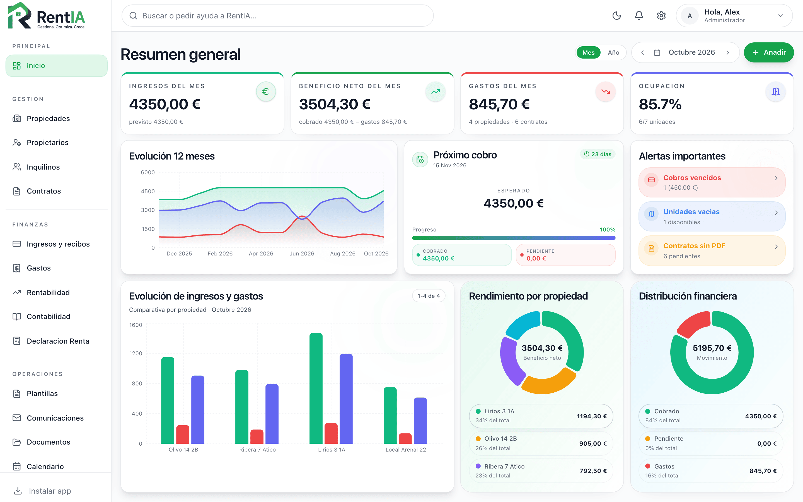

> This repository is a case study. The source code is private; what is here is a description of
> the product and its engineering, with screenshots of the current production version running
> locally on synthetic data. Every name, address, ID and amount in the images is invented. The app's
> UI is in Spanish because its users are.

---

## The problem

Renting out a few flats in Spain looks simple until you do it every month:

- **Contracts under the LAU** (Ley de Arrendamientos Urbanos): tenants can extend a residential
  lease year by year up to five years (seven with a corporate landlord), with notice windows before
  each renewal and before that limit, and different paperwork for whole flats and for rooms.
- **Rent updates by index.** For residential leases signed after May 2023, the annual update is
  tied to the INE's IRAV index (published since 2025) instead of the CPI (IPC). Someone has to look
  up the right figure, apply it on the contract anniversary and notify the tenant in writing.
- **Deposits** (fianzas) have to be tracked, returned within the legal window after a lease ends,
  and kept out of taxable income.
- **Bills and receipts.** Water, electricity and community fees arrive as PDFs and photos, some
  are passed on to the tenant in the next month's receipt, some are tax-deductible, and each one
  has to be assigned to the right property.
- **Tax.** The yearly income tax return (IRPF, Modelo 100) needs income and deductible expenses per
  property, building depreciation, the reduction that applies to each lease, and imputed income for
  the days a property sat empty.

Spreadsheets cope until they do not: a lease that starts on the 21st, a water bill that belongs to
next month's receipt, a deposit that was counted as income. RentIA puts the whole cycle in one
place and derives what can be derived instead of asking for it twice.

## What it does

Everything below exists in the production codebase.

**Portfolio and leases**
- Properties as whole flats, flats let by the room, holiday lets, commercial units and storage
  units, with an owners view: multiple owners per property, ownership percentages and per-owner
  yearly income.
- Tenants with co-tenants and guarantors. ID cards (DNI/NIE) are read by OCR to prefill the form.
- Contract generation from Word templates per contract type (whole flat or room), rendered to PDF,
  with annexes such as house rules for shared flats.
- Uploading an existing contract PDF extracts its key terms with a local model.
- Optional digital signature: PAdES signing with the landlord's certificate, and remote signing by
  the tenant through a self-hosted DocuSeal instance.

**Money**
- Monthly rent receipts generated per active contract, with day-based proration when a lease
  starts or ends mid-month, and one-off income (bookings, deposits) in the same ledger.
- Bills passed on to the tenant are added to the rent receipt of the month they are assigned to,
  and never to one-off income in the same month.
- Receipt PDFs archived next to the payment. Overdue status is derived on read, never stored.
- Invoice upload with OCR: amount, date, category and property extracted and proposed for review.
- Profitability per property (yield, net income, month-by-month actuals) and accounting summaries.
- Exports to CSV and Excel, plus the data behind tax forms Modelo 100, 180 and 303.

**Compliance**
- IRAV and IPC fetched from the INE API with scraping and cache fallbacks, applied on the contract
  anniversary, with a generated rent-update letter for the tenant.
- Scheduled notices: payment reminders, renewal notice 60 days before the end of a lease, annual
  review 30 days before the anniversary, and a 120-day warning before the five-year LAU limit.
- Deposit tracking with a dashboard alert when a return is past the 30-day legal window.
- IRPF return per property: AEAT box numbers, depreciation, lease-based reductions (Ley 12/2023)
  and imputed income for vacant days.
- Optional Verifactu module (Spanish e-invoicing regulation): chained SHA-256 records, QR codes on
  receipts and submission to the tax agency over mutual TLS.

**Intelligence**
- Chat over your own portfolio. Figures are computed in Python and given to the model as context;
  the model writes the answer, it does not do the arithmetic.
- Semantic search inside your documents ("what does the deposit clause in this lease say?"), with
  the source document cited in the answer.
- Global search, calendar with ICS export, notifications and a full event log of user actions,
  errors, AI calls and timings.

## Screenshots

| | |
|---|---|
|  **Dashboard.** Month or year view: income, net profit, expenses, occupancy, next collection, alerts and per-property performance. | 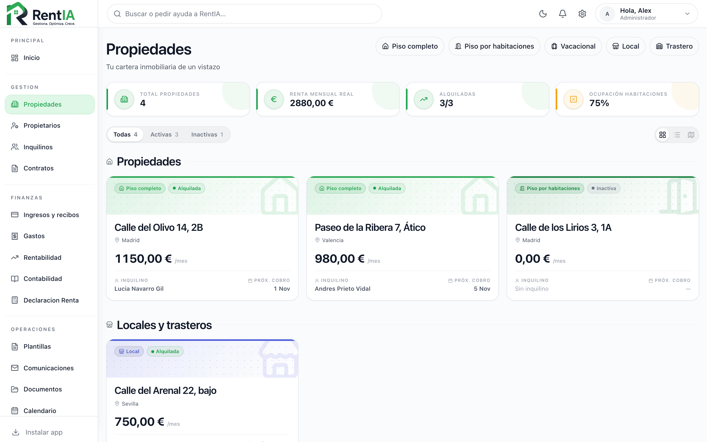 **Properties.** Whole flats, flats let by the room, holiday lets, commercial units and storage. |
| 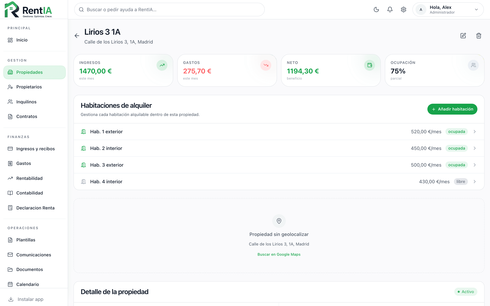 **Flat let by the room.** Each room with its rent and status, and the flat's income, expenses and occupancy. | 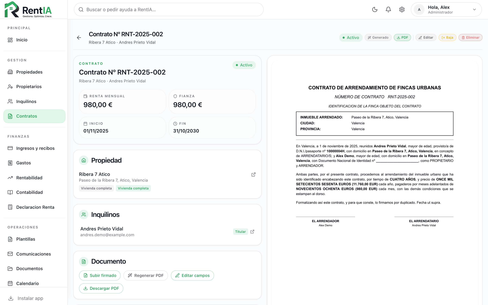 **Contract.** Lease terms next to the PDF generated from the template, with signing, termination and regeneration actions. |
| 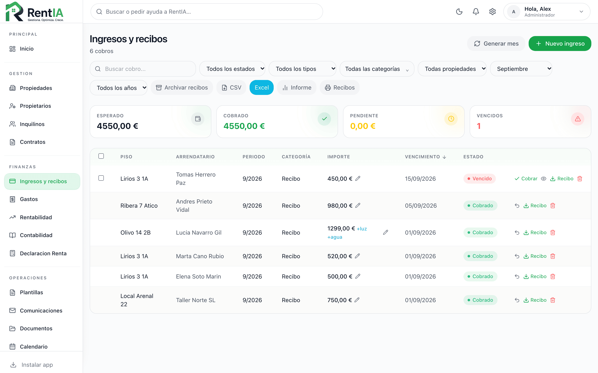 **Income and receipts.** Rent and one-off income in one ledger; bills passed on to the tenant show up as `+luz` or `+agua` on the receipt they belong to. | 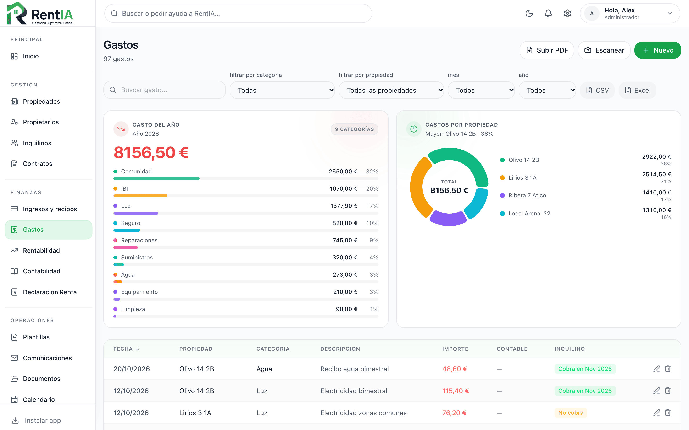 **Expenses.** Granular categories, PDF upload and camera scan, and whether and in which month the tenant is charged. |
| 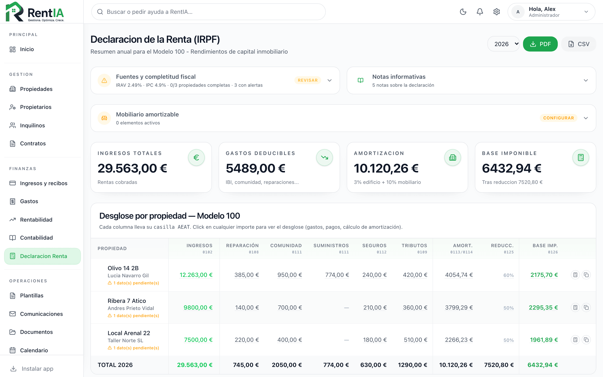 **Income tax return.** Per-property Modelo 100 breakdown with AEAT box numbers, depreciation, reductions and a data-completeness check, with live IRAV and IPC. | 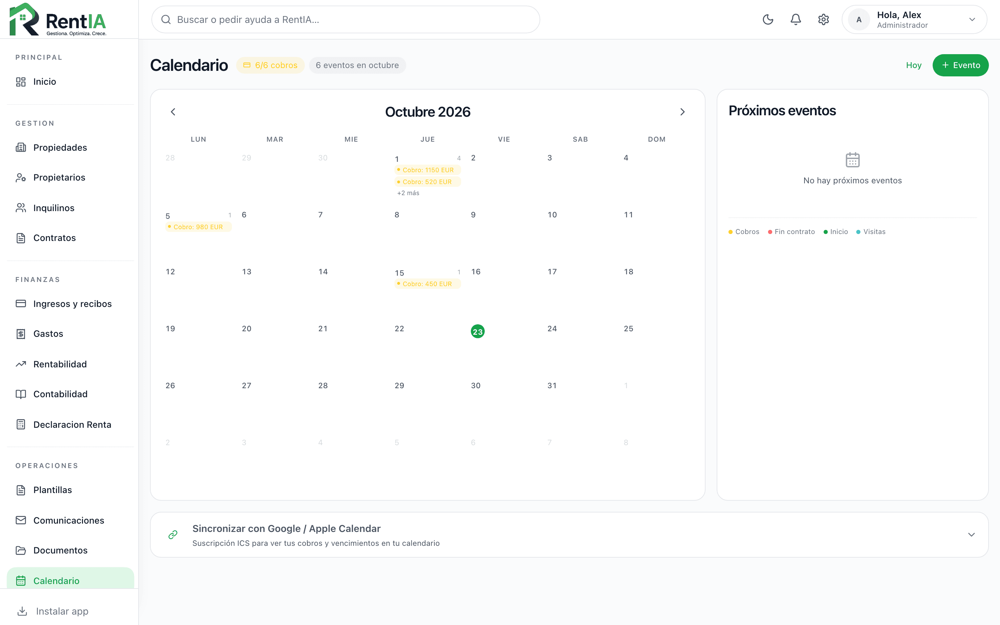 **Calendar.** Collections, lease starts and ends, with an ICS feed for Google or Apple Calendar. |

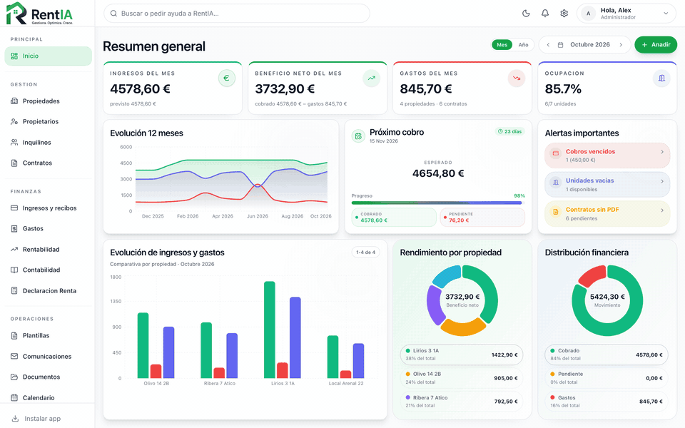

Not shown: document OCR and chat, which need the local models, and Verifactu, which is disabled
by default.

## Architecture

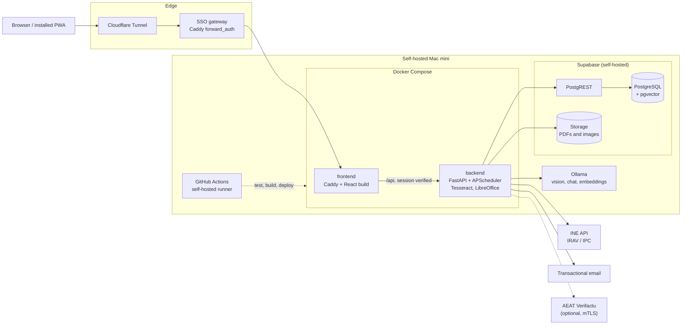

- **Nothing is exposed directly.** Container ports bind to loopback; the only way in is the tunnel,
  then single sign-on, then the frontend's own session check before any API call reaches FastAPI.
- **One backend, no ORM.** FastAPI routers per domain over a thin store layer on PostgREST. Domain
  rules (periods, proration, what counts as income) live in small pure modules shared by the API,
  the scheduler and the chat, so the three cannot disagree.
- **Models stay on the host.** In production everything runs locally through Ollama on the same
  machine; no document or chat data leaves the server. The code supports an optional hosted
  provider as a fallback, and it is disabled.
- **Deploys are gated.** Push to `main` runs backend tests, lint and the Docker build, then the
  frontend lint, tests and production build. Only if all of that is green does the deploy job pull,
  rebuild, wait for Docker health checks, and roll back to the previous commit automatically if
  they fail.

More detail in [docs/architecture.md](docs/architecture.md).

### Document and OCR pipeline

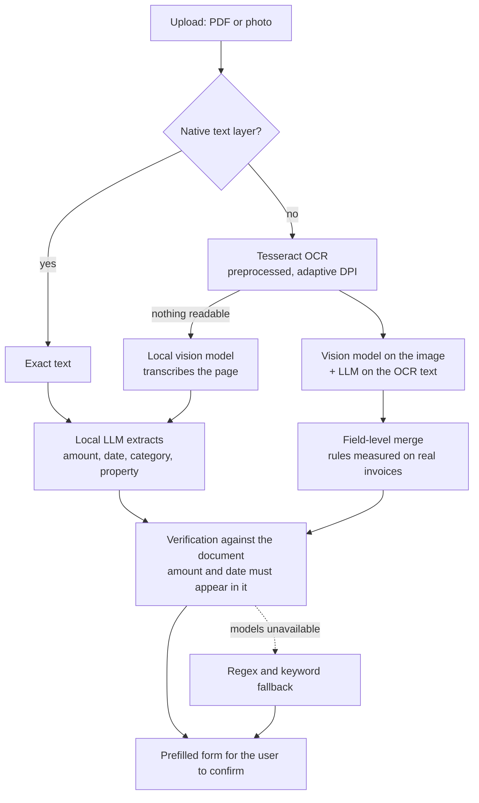

The full pipeline, including how DNI/NIE cards are validated with MRZ check digits, is in
[docs/document-pipeline.md](docs/document-pipeline.md). Legal rules are covered functionally in
[docs/compliance.md](docs/compliance.md).

## Key engineering decisions

**Deterministic first, AI where it earns its place.** Rent amounts, proration, overdue status,
index updates, deposits and tax figures are plain code with tests. AI is used for the two jobs code
does badly: reading messy documents and phrasing answers. Even in chat, the numbers are computed in
Python and the model is told to copy them, not recompute them.

**Verify the model instead of trusting it.** A small model asked to list seven tenants would
sometimes name three. Prompting reduced it but did not remove it, so the backend now checks the
answer against the retrieved data, retries once naming what was left out, and falls back to the
complete data block if the model still summarises. On invoices, an amount or date that does not
appear in the document's own text is discarded rather than saved.

**Measure before adding machinery.** Tool-calling to route chat questions was built, measured on
questions without keywords, and left off by default because it did not improve accuracy. A larger
chat model was rejected for being 72% slower without better answers. The vector index is
deliberately absent until the document volume makes it worth having.

**Privacy by architecture.** The users' data includes ID numbers, bank details and signed leases.
In production, OCR, extraction, chat and embeddings all run on local models on the same machine as
the database, so no document or chat data leaves the server. The semantic search function filters by user inside SQL, so no
caller can forget the filter, and it respects per-viewer property visibility so the chat cannot
become a side door into hidden data.

**One source of truth per rule.** Each business rule lives in one module and every consumer imports
it: the receipt generator, the scheduler, the dashboard and the chat. When production surfaced a
class of bug, such as client cache keys that were never invalidated, the fix included a test that
pins the invariant, not just a patch for the symptom.

**Boring, observable operations.** Docker Compose with health checks, capped log files, a
persistent log volume, a request ID on every call and an event log the owner can browse from the
app. Every AI call is logged with model, latency and truncated prompt and output.

## In production

RentIA is not a demo. It has been running on a self-hosted Mac mini and is used every month by a
small group of real landlords to issue receipts, file expenses, track deposits and prepare their
tax return. That is where most of the decisions above come from: each one has a concrete incident
or measurement behind it.

At the time of writing the private codebase has around 270 API endpoints, 58 database migrations,
500+ backend tests that run against an in-memory store, and frontend unit tests, all gated in CI
before every deploy.

## Roadmap

- Verifactu: move from the per-user beta flag to general availability ahead of the 2027 deadlines
  for companies and self-employed landlords.
- A hosted multi-tenant edition with isolated accounts and billing, already prototyped separately.
- A vector index for document search once the corpus is large enough for it to help recall and
  latency instead of hurting them.

## Code access

The code is private. I am happy to walk through it, including the architecture, the tests and the
production setup, in a call: [LinkedIn](https://www.linkedin.com/in/diego-perez-garcia).

## License

The text and images in this repository are copyright (c) 2026 Diego Pérez. All rights reserved.
See [LICENSE](LICENSE).
