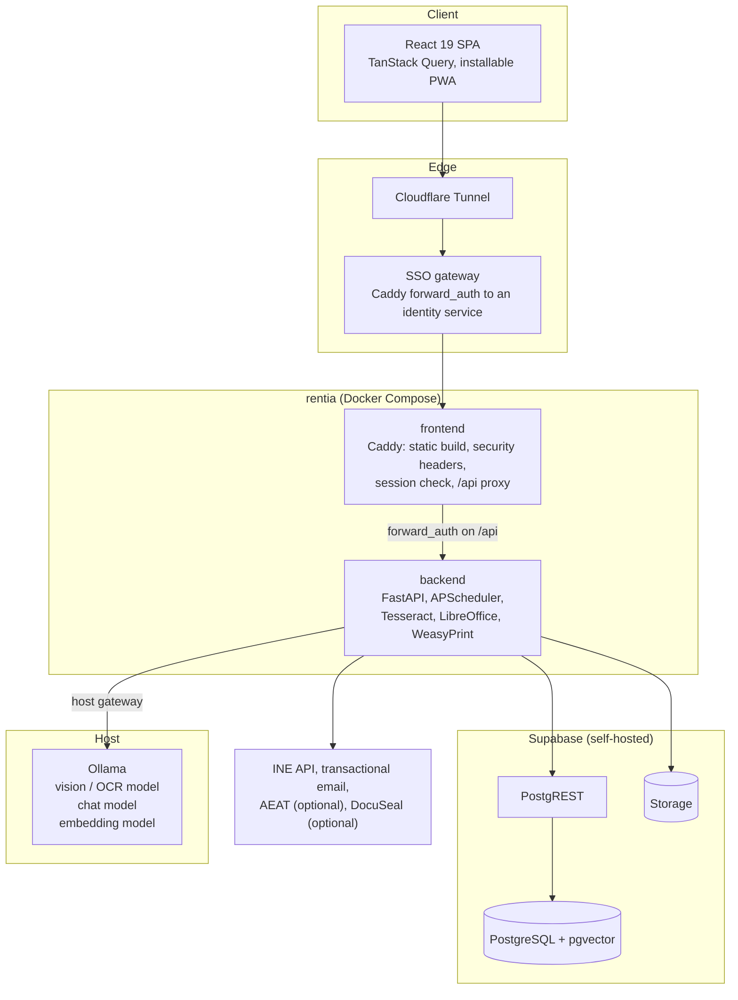
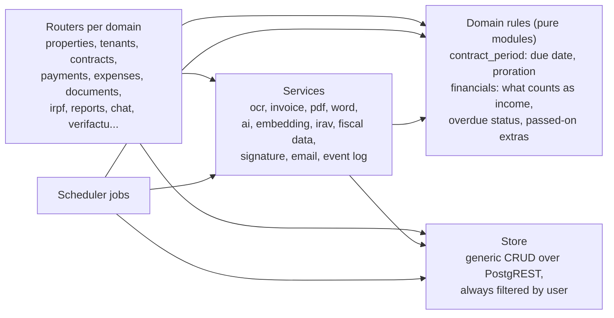
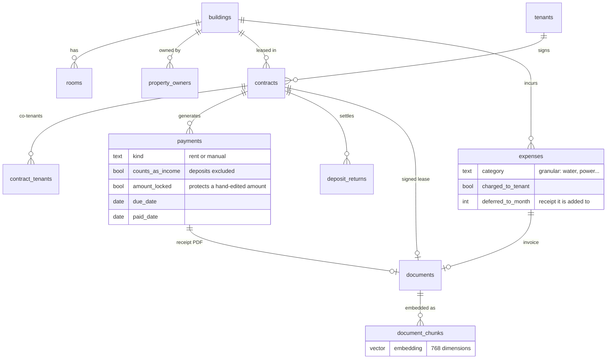
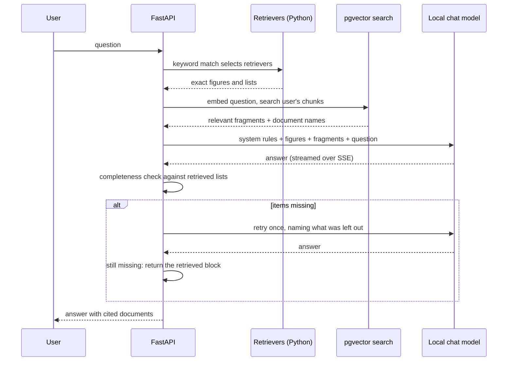
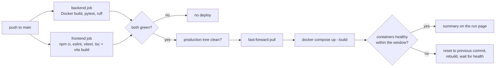

# Architecture

RentIA is a single-page React app served by Caddy, a FastAPI backend, and a self-hosted Supabase
(PostgreSQL, PostgREST and Storage). It runs with Docker Compose on a Mac mini, behind a Cloudflare
Tunnel and a single sign-on gateway. Language models run locally on the same machine through
Ollama.

## Services

| Layer | Technology |
|---|---|
| Frontend | React 19, TypeScript 5, Vite, TanStack Query v5, Recharts, Lucide, PWA |
| Backend | FastAPI on Python 3.12, APScheduler, no ORM (thin store over PostgREST) |
| Data | PostgreSQL with pgvector, PostgREST, Supabase Storage |
| Documents | PyMuPDF, Tesseract (spa + eng), docxtpl and LibreOffice for contracts, WeasyPrint for receipts |
| AI | Ollama: a vision model for OCR, a small chat model, `nomic-embed-text` for embeddings |
| Crypto | pyHanko (PAdES), signxml (XAdES), cryptography (Fernet) for stored certificates |
| Infra | Docker Compose, Caddy, Cloudflare Tunnel, GitHub Actions on a self-hosted runner |

## Request path and security

1. The browser reaches the Cloudflare Tunnel; no port on the host is published to the internet.
2. The SSO gateway authenticates the user before anything is served.
3. The frontend's Caddy asks the backend to verify the session (`forward_auth`) on every API
   request, so an invalid token never reaches a handler. Strict security headers and a CSP are set
   there.
4. The backend validates the JWT (header or cookie, with CSRF protection for cookie sessions) and
   scopes every query by `user_id`.
5. Compose binds container ports to loopback only, and the stack is split into dedicated Docker
   networks so RentIA does not share a network with other services on the same host.

## Backend structure

The rules that decide money live in small modules with no I/O, and every consumer (API, scheduler,
dashboard, chat context builder) imports them. That is what keeps the dashboard, the receipts and
the chat from giving three different answers to the same question.

### Scheduled jobs

| Job | When | What |
|---|---|---|
| Generate monthly receipts | 1st of month | One receipt per active contract, prorated when needed |
| Recurring expenses | 1st of month | Fixed costs per property |
| Expire contracts | Daily | Leases past their end date |
| Payment reminders | Daily | Tenants with a payment due in three days |
| Renewal notices | Daily | 60 days before a lease ends |
| Annual review | Daily | 30 days before the anniversary, with the current IRAV |
| Five-year LAU notice | Daily | 120 days before the five-year limit |
| Overdue check | Every 6 hours | Overdue notifications and emails |
| Fiscal indices | Every 6 hours | Pre-warms the IRAV and IPC cache |
| Verifactu (optional) | 60 s / hourly / daily | Dispatch, reconciliation, certificate health, backup |

Jobs run with `max_instances=1` and coalescing, so a slow upstream (the INE API, for example)
cannot stack overlapping runs. Frequent jobs only write to the event log when they did something.

## Data model

Tables are prefixed `rentia_` and every row carries `user_id`.

Two details that matter in practice:

- The unique index that prevents duplicate receipts is partial (`WHERE kind = 'rent'`), so a
  one-off booking fee and the monthly receipt can coexist for the same contract and month.
- A hand-edited receipt amount is locked, so a later rent change does not overwrite it.

## Chat and document search

- Structured retrievers compute figures in Python (overdue payments, occupancy, ranking by net
  income, tenants per property). Every retriever that matches runs; their output is context, not
  the reply, so answers do not read like templates.
- A tool-calling router exists for questions with no keywords. It was measured, did not improve
  accuracy because the base context already covers those cases, and ships disabled.
- Document search embeds with `nomic-embed-text` locally and queries through a SQL function, since
  PostgREST does not expose the vector operator. The `user_id` filter lives inside the function, and
  hidden properties are excluded per viewer.
- Chunks are about 1,000 characters with 150 of overlap, split on paragraphs so a contract clause is
  not cut in half. New uploads are indexed in a background task; a backfill script handles history
  and model changes.
- If no model answers but data was retrieved, the raw data is returned instead of an error.

## Delivery

- Everything runs on a self-hosted GitHub Actions runner on the production machine, so the Docker
  layer cache is warm and the whole pipeline takes about a minute.
- Backend tests run inside the freshly built image against an in-memory store, with dummy
  credentials that point at an invalid host, so a test that tried to reach a real database would
  fail instead of touching production.
- Runs are queued, not cancelled, because cancelling a deploy halfway could leave production in an
  unknown state.
- Deploys refuse to start if the production checkout has uncommitted changes, and use fast-forward
  merges only.

## Observability

- A request ID on every request, propagated to logs.
- An event log, browsable in the app, with user actions, API errors, AI calls (model, latency,
  truncated prompt and output) and job runs, each with its own retention period.
- Log files on a persistent volume with size caps, so a rebuild does not wipe the logs needed to
  debug that very deploy.
