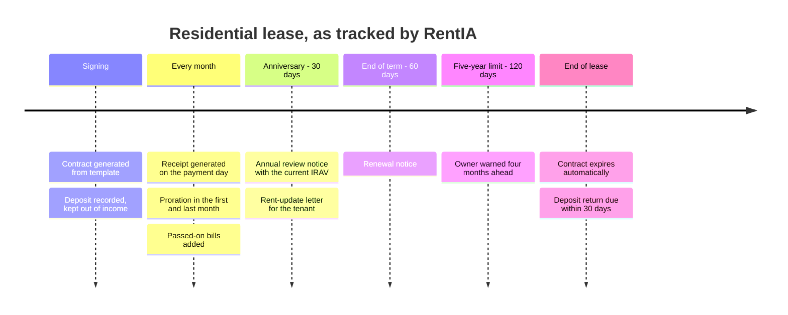
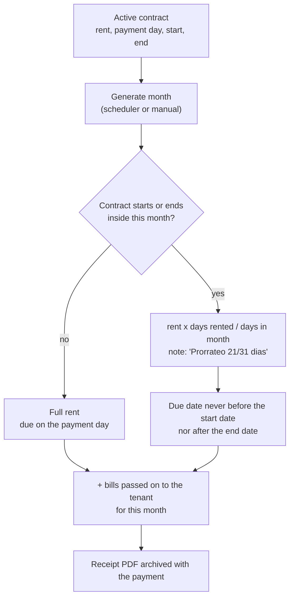
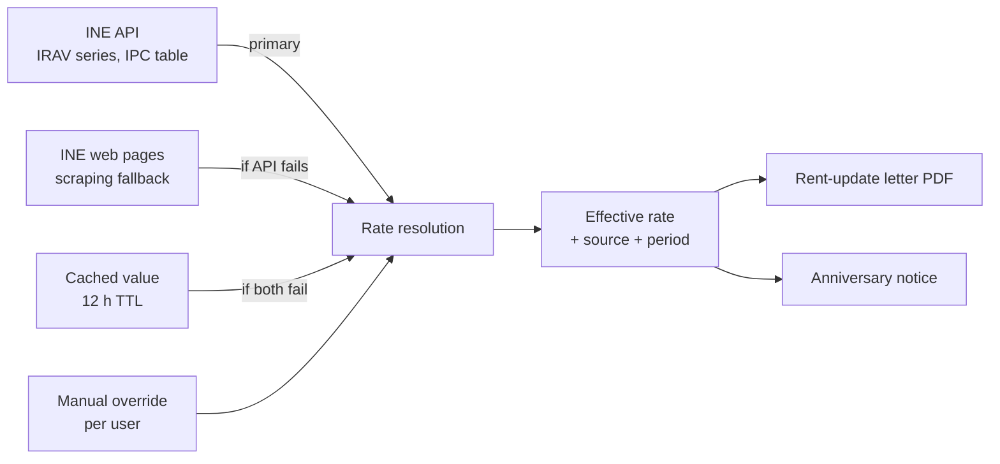
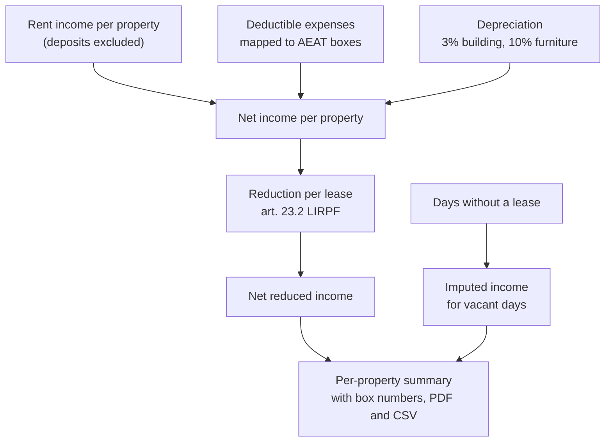

# Compliance: LAU, rent indices, deposits and tax

This page describes, at a functional level, which Spanish rental and tax rules RentIA encodes and
how. It is a description of the software, not legal advice. Where a rule is a legal reference, the
app treats it as a deterministic calculation with tests; AI is not involved in any of it.

## Lease lifecycle under the LAU

The Ley de Arrendamientos Urbanos governs residential leases. RentIA models the parts that create
deadlines.

| Event | When RentIA acts | What it does |
|---|---|---|
| Rent due | Payment day of each month | Generates the receipt, emails a reminder three days before |
| Overdue | Derived when read | A receipt is overdue if unpaid and past its due date; never stored as a flag that can go stale |
| Anniversary | 30 days before | Notifies the owner with the index to apply and the resulting rent |
| End of term | 60 days before | Renewal notice |
| Five-year limit | 120 days before | Notice for leases running about five years, the statutory minimum for individual landlords |
| End of lease | On the end date | Marks the contract expired; deposit return becomes due |
| Deposit return | 30 days after the end | Dashboard alert once the legal window is exceeded |

Every notice is deduplicated by reference, so the same event never emails twice, and stale
notifications (a payment that has since been collected, a lease that was rescinded) are removed
instead of lingering.

### Receipts and proration

- One function computes due date and amount, and all three paths that create receipts (new contract,
  manual generation, the monthly job) call it. Before that existed there were three formulas that
  disagreed.
- A first receipt cannot be born overdue: a lease starting on the 11th with payment day 5 is due on
  the 11th.
- A hand-edited amount is locked so later rent changes do not overwrite it.
- One-off income (booking fees, deposits) shares the ledger with rent but is flagged so it does not
  count as taxable income when it should not.

### Passing bills on to the tenant

Expenses carry three independent attributes: a granular category (water, power, internet), an
accounting category, and the tax box it belongs to. Whether the tenant is charged, and in which
month, is a separate decision:

- Water bills are deferred automatically to the next month's receipt.
- Other bills need an explicit month; until one is chosen the expense is flagged as missing it
  rather than silently assumed.
- Bills are grouped per property and month and added to that month's rent receipt only, never to
  one-off income such as a booking fee in the same month.

## Rent updates: IRAV and IPC

For leases signed after 26 May 2023, the annual rent update is tied to the INE's IRAV index (Ley
12/2023), published since 2025; older leases typically reference the CPI (IPC).

- The official API is the primary source. Each value carries its source (`api`, `scrape`, cache,
  `manual`) and period, so the user can see where a number came from.
- IPC readings older than 18 months are rejected as stale rather than applied.
- A background job refreshes the indices every six hours, so opening the tax or contract screens
  never waits on the INE.
- If every live source fails, the last cached value is used with an explicit warning. A manual
  override per user covers the case where the landlord and tenant agreed on a figure.
- The rent-update letter is generated as a PDF with the rate, its reference period and the
  anniversary date.

## Deposits

- Deposits are recorded with the contract and excluded from taxable income.
- When a lease ends, the deposit return is tracked; the dashboard flags returns that exceed the
  30-day window of the LAU.
- Amounts retained from a deposit (for damage, for example) are recorded and counted as income in
  the month they are retained.

## Income tax (IRPF, Modelo 100)

- **Expenses** are mapped from granular categories to the boxes of the return, so a detailed
  breakdown (power, water, internet) does not fragment the tax view.
- **Building depreciation** uses 3% of the greater of the acquisition cost excluding land and the
  cadastral value of the construction; furniture and appliances depreciate separately.
- **Reductions** follow Ley 12/2023: 50% general for leases from 26 May 2023, 60% for older leases
  (transitional) or recent rehabilitation, 70% for young tenants in stressed-market zones, and 90%
  for new leases in those zones with a rent cut of at least 5%.
- **Imputed income** is computed for the days a property was not let, and the summary warns when
  data needed for the calculation is missing.

Other forms supported with data exports: Modelo 180 (withholdings on commercial leases) and
Modelo 303 (VAT on commercial leases).

## Verifactu (optional)

Spain's Verifactu regulation (RD 1007/2023 and Orden HAC/1177/2024) requires invoicing software
used by companies and self-employed professionals to produce tamper-evident records. A private
landlord letting a home without an economic activity is not covered, so the module is off by
default and has no effect on the receipt flow when disabled.

When enabled:

- Every collected receipt produces a registration record whose SHA-256 fingerprint is chained to
  the previous one, verified against the official test vectors.
- Records are sent to the tax agency's web service over mutual TLS with the landlord's certificate,
  or signed locally (XAdES) and retained in the non-submission mode.
- Each receipt carries the agency's verification QR code.
- Corrective and cancellation records are supported, and the simplified invoice type is selected
  automatically below the legal threshold.
- The chain can be re-verified on demand. Scheduled jobs dispatch pending records, reconcile
  responses, warn 30, 15, 7 and 1 days before the certificate expires, and back up the records
  daily.
- Certificates are stored encrypted (Fernet) and rollout is gated per user.

## Contract signing (optional)

- **Landlord**: PAdES signature with the landlord's own certificate, placed automatically in the
  signature blocks of each page. Once signed, the PDF is frozen so it cannot be regenerated by
  accident. RFC 3161 timestamps are supported.
- **Tenant**: remote signing through a self-hosted DocuSeal instance. Webhooks are verified with
  HMAC and the signed PDF is attached to the contract. This is a simple electronic signature under
  eIDAS, which is sufficient for residential leases in Spain.
