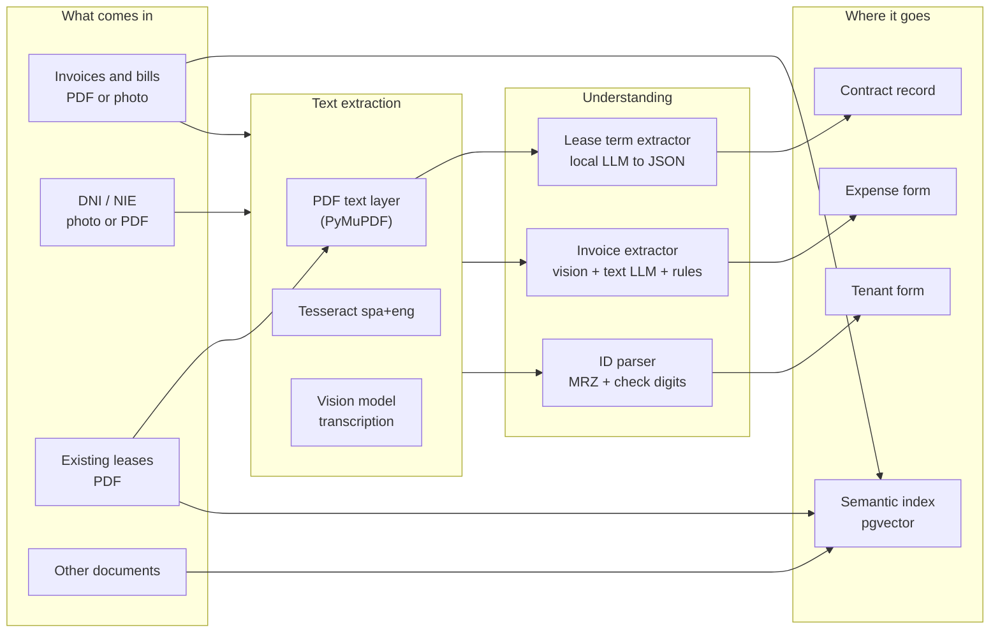
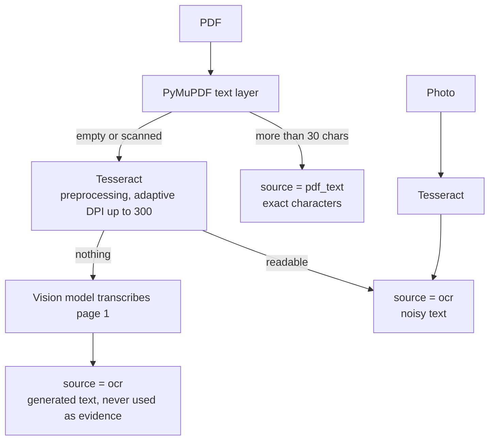
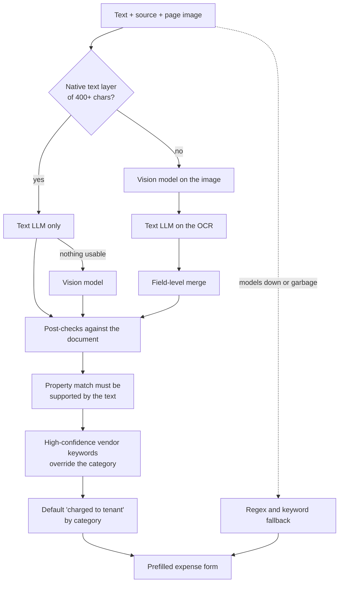
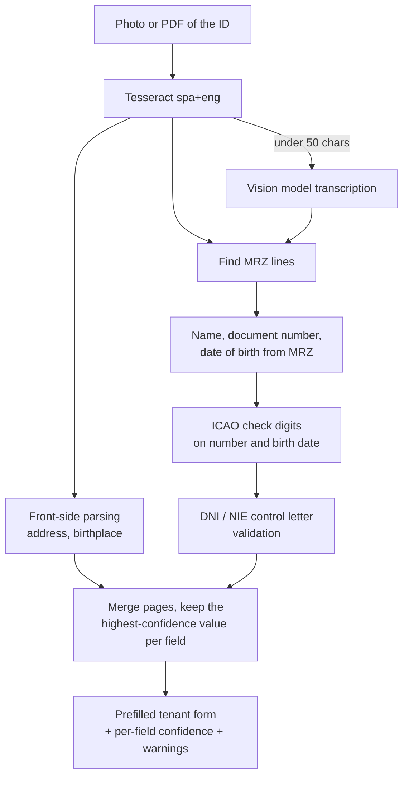

# Document pipeline: OCR and extraction

Landlords receive paperwork in every possible shape: digital PDFs from utilities, phone photos of
hardware-store tickets, scanned ID cards, signed leases. The pipeline turns each one into a
prefilled form the user confirms. In production everything runs locally on the server: Tesseract
in the backend container and local models through Ollama. No document data leaves the server. The
code supports an optional hosted model as a fallback for lease extraction, and it is disabled.

The guiding rule is that a wrong value saved silently is worse than an empty field. A missing date
gets noticed and filled in; an invented one ends up in the wrong tax year.

## Overview

## Getting text out of a file

Every extraction returns the text and its source, because the source decides how far the text can
be trusted later:

- **`pdf_text`**: the document's own characters. Exact.
- **`ocr`**: Tesseract output. Digits get dropped, columns get mixed up.
- **Vision transcription** is only a last resort. On a bad photo a model will happily write a
  plausible "issue date: 1/05/23" on a 2026 invoice, so this text can feed the extractor but can
  never be used to confirm a value.

## Invoices

### Which source wins, field by field

On scanned documents both a vision model (reading the image) and a text model (reading the OCR)
produce candidates. The merge rules were set by measuring both on the real invoices the app had
processed, and they differ per field:

| Field | Winner | Why |
|---|---|---|
| Amount | Vision | Where they disagreed, vision was right every time. The text model works on noisy OCR and picks wrong columns (a discount percentage) or split digits. |
| Date | Text, never vision | Vision invented the year in every disagreement (2023 or 2024 on 2026 invoices). |
| Category and description | Text | It reads characters and names the actual products and vendor. |

A tempting shortcut was rejected: using "does the value appear in the OCR text?" to arbitrate the
amount. That test is circular, since the text model's value comes from the OCR and always appears
there, so it made the wrong value win.

### Post-checks

- **Amount must appear in an exact text layer.** If the document has a native text layer and the
  model's amount is not written anywhere in it, the model summed or invented it. A utility bill with
  a misaligned table produced exactly that; the printed total is used instead when the regex finds
  it in the text.
- **Dates must appear in the document.** On OCR text, a date heuristic repairs digits Tesseract
  dropped. If the final date is still not in the document, it is discarded and the form asks for it.
- **The issue date, not the billing period.** The prompt asks for the labelled issue date, because
  the first date on most bills is the start of the billed period.
- **Property match is verified.** The chosen property must be supported by the customer address or
  postcode in the text, not the vendor's. With a single property the match is trivial.
- **No examples to copy.** The extraction prompt does not include sample values, because small models
  copied them into the output.

### Operational limits

- One time budget (75 s) is shared by all stages of an analysis, so a slow stage cannot starve the
  rest or hang the request.
- Analyses run one at a time. Ollama serves one generation at a time anyway, and two concurrent
  generations double peak memory on the host.
- When no model is available, regex and keyword rules still return amount, date, category and a
  description, so the feature degrades instead of failing.

## ID cards (DNI / NIE)

- The machine-readable zone (MRZ) on the back of the card is the most reliable source: the parser
  extracts name, number and date of birth and verifies the ICAO check digits.
- The document number is validated independently with the official control-letter algorithm (and the
  X/Y/Z prefix mapping for NIE).
- Check-digit failures on the number are common on phone scans, so a warning is raised only when the
  birth-date check also fails or is missing. That keeps false alarms down without hiding real
  inconsistencies.
- Front and back can be uploaded together; results are merged per field by confidence.
- Names are normalised from the uppercase print to proper case.

## Leases

Uploading an existing lease PDF extracts tenant name, ID number, address, monthly rent, deposit,
start and end dates and payment day as JSON with a local model, to prefill the contract record.
Categories that do not need extraction (deposit receipts, ID scans) skip the model entirely.

## Semantic index

Every uploaded document is also indexed for search, in a background task so the upload returns
immediately:

1. Text is extracted with the same cascade as above.
2. It is split on paragraph boundaries into chunks of about 1,000 characters with 150 characters of
   overlap, so a clause cut in half is still retrievable. Fragments under 40 characters are dropped.
3. Chunks are embedded locally with `nomic-embed-text` (768 dimensions) and stored in PostgreSQL
   with pgvector.
4. Search goes through a SQL function that filters by user inside the database.

If Ollama is down during indexing, the text is stored without a vector and a backfill script
completes it later without re-reading the PDFs. The same script reindexes everything after a model
change.

## Observability

Every OCR and model call goes through a single function per kind, instrumented with model name,
input size, latency and outcome, and recorded in the app's event log. When the configured OCR model
changed, the logs reported the real model name instead of a hard-coded label, which matters when
comparing accuracy before and after.
